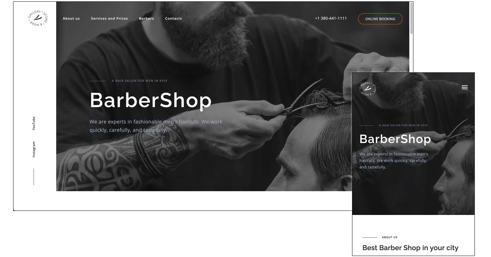

# Barbershop — Responsive Landing Page

A responsive, single-page website created as an HTML/CSS coursework project. The focus is frontend implementation: page structure, responsive layout, SCSS organization, and small JavaScript interactions.

**This is a fictional business demo, not a real barbershop or an active booking service.**

[View the GitHub Pages demo](https://andriidorohov.github.io/site-Barbershop/) · [View the source](https://github.com/AndriiDorohov/site-Barbershop)



## Highlights

- Semantic HTML structure for a single-page marketing website.
- Responsive styling with organized Sass partials and compiled CSS.
- Mobile navigation menu and in-page section links.
- Smooth scrolling for valid section anchors, with reduced-motion support.
- Back-to-top control and presentation sections for services, barbers, and contacts.

## Stack

- HTML5
- CSS3 and SCSS (Sass)
- Vanilla JavaScript for the scroll-to-top control and section navigation
- jQuery (legacy dependency for mobile-menu behavior)
- GitHub Pages for the static demo

## Run locally

No backend or install step is required to view the committed static website.

```bash
git clone https://github.com/AndriiDorohov/site-Barbershop.git
cd site-Barbershop
python3 -m http.server 8000
```

Open <http://localhost:8000> in your browser. Stop the local server with Ctrl+C.

The committed `css/main.css` is already compiled; it can be used without installing Sass. SCSS sources live under `sass/` and the entry point is `sass/main.scss`.

If you want to edit styles and have the Sass CLI available, compile them with:

```bash
sass sass/main.scss css/main.css
```

## Main files

```text
index.html             Page content and markup
css/main.css           CSS used by the page
sass/main.scss         SCSS entry point
sass/components/       Component-level styles
sass/utils/            Sass shared variables
js/menu-button.js      Menu ARIA state
js/body-fixed.js       Mobile menu and body-scroll behavior (legacy jQuery)
js/id-scroll.js        Internal navigation / smooth scroll
js/totop.js            Back-to-top button
images/                Illustrations, icons, and project screenshot
```

## Demo limitations

- The appointment form is a **visual prototype**, not a functional booking system. Do not submit personal details; there is no booking backend or email integration.
- The business address, phone number, opening hours, and social links are placeholders.
- Several social links are `#` placeholders; contact links and forms need cleanup.
- The project currently relies on a legacy jQuery CDN script for parts of the mobile-menu UI.
- Automated tests, accessibility checks, and a build pipeline have not yet been set up.
- This README documents source-code behavior; browser compatibility and the live GitHub Pages deployment still need to be rechecked.

## Planned improvements

1. Review and repair inactive links, form behavior, and mobile menu interaction.
2. Improve keyboard accessibility, image alternatives, and reduced-motion behavior.
3. Remove unnecessary JavaScript and jQuery where practical.
4. Verify responsive layouts and add lightweight automated checks.
5. Revisit the published demo after testing the revised site.

## Project context

This is a learning project. It demonstrates frontend fundamentals and is kept separate from larger backend, full-stack, and DevOps repositories. Features described as demonstrations should not be mistaken for real business functionality.
